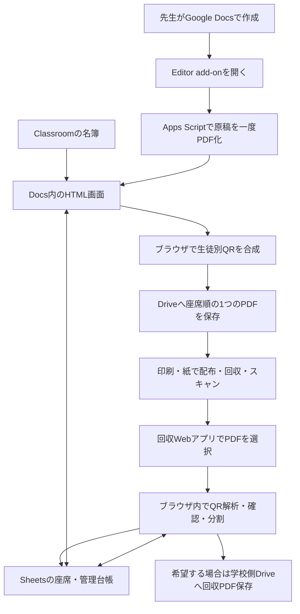

# PaperFlow 詳細設計案 v3 — DevFest Hackathon 2026 / R2K2

作成日：2026年11月9日（日本時間）

状態：実装前の推奨設計。ハッカソン条件・8項目の評価への対応を反映。コード・実機検証・Google環境の設定変更は未実施。

## 1. この設計の根拠と適合条件

参加イベントはDevFest Hackathon 2026、チームはR2K2。企画段階の議論と運営資料を要件として反映した。

[公式サイト](https://df-hack26.gdgs.jp/)では、Google技術、完成度、課題解決、ピッチという4つの審査観点と、開発期間11月5〜10日を確認した。[提出用README](https://github.com/Devfest-Hackathon-2026/df-2026-t014/blob/main/README.md)では提出・公開・実行環境の制約を確認した。8小項目の文言と0〜3点/計24点、5カテゴリ、インフラ候補の詳細はユーザー提供の運営資料に基づく。これらの詳細を公開サイトにも掲載されていたとは扱わない。

| 条件 | PaperFlowの設計上の対応 | 根拠・状態 |
|---|---|---|
| 身近なコミュニティの問題を解決 | Classroomを利用する学校・塾のクラスで紙の配布・回収を支援 | ユーザー提供のテーマに適合する設計 |
| 5カテゴリのいずれか | 教育カテゴリとして提出 | ユーザー提供の参加条件 |
| Google系インフラ候補 | Firebase HostingでWebアプリを配信 | 提供された候補に含まれる。デプロイ自体は未実施 |
| Google技術が中核で機能 | Classroom、Docs、Apps Script、Drive、Sheetsを業務に組み込む | 4大観点は公式サイトでも確認 |
| 8項目・各0〜3点、計24点 | 第16章で設計・試験・資料の証拠を対応付ける | 詳細配点はユーザー提供。獲得点の予測はしない |
| 提出リポジトリが審査対象 | 最終コード、設定例、再現手順、検証資料を提出先に含める | README確認済み |
| 提出先でActions/Pages利用不可 | 開発用リポジトリを分離。FirebaseへCLI等でデプロイ | README確認済み。禁止は提出用リポジトリに対するもの |
| public・秘密情報のコミット禁止 | 実名簿/実書類/認証情報を含めず、架空資料と設定例を提出 | README確認済み。履歴も検査対象 |
| デプロイURLの掲載 | READMEにFirebase URLと各評価経路を記載 | README確認済み |
| Gemini・生成AIの必須性 | 現時点ではプロダクトへ追加しない | 提供条件と取得した公開ページには必須との明記を確認できず |
| 正式な締切時刻、提出フォーム、ピッチ時間 | 運営案内で確定する | 未確認。開発終了日から時刻を推定しない |

基本方針は維持する。Classroom、座席表、座席順の単一PDF、QR四隅選択を含む一連の製品を作る。回収判定にLLMは使わず、生徒用アプリ、QRシール、新規ハードウェアを要求しない。今回のv3では、任意のPDF保管、審査員のアクセス経路、評価に必要な測定と提出物を追加した。

## 2. プロダクトの約束

Google Classroomを使うクラスの先生が、いつものGoogle Docsで作った紙を座席順に配り、回収した束をスキャンすると、誰のどのページが戻ったかを確認でき、Sheetsの一覧更新と、必要に応じたDriveへの書類保管まで終えられる。

主な対象は、保護者向け同意書、申込書、確認票など。デモは架空の修学旅行参加同意書で統一する。扱う単位は「クラス」「配布物」「その配布物の版」「生徒に発行したページ」。

初期の利用者仮説は、回収確認に加えて書類の電子保管も必要な先生を優先する。既にスキャンする運用なら、照合・転記・仕分けの改善を試しやすい。紙だけで管理している先生への有効性は、新たに必要になるスキャンも含めて別途測定する。

保証するのは、登録された発行先に対応する紙の回収と、必要ページの充足である。QRのある白紙も読み取れるため、記入完了・本人提出・署名の真正性・同意内容までは自動保証しない。画面の主要表記を「回収済み」にし、「必要ページが揃っています」と説明する。

「先生の作業がゼロになる」とは表現しない。初回の名簿補完と座席設定、印刷操作、束のスキャン、例外確認は必要。配布先の照合、提出表への転記、ファイル仕分けの負担を減らすことを目標にする。

## 3. 採用する全体構成

**配布はDocs Editor add-on、回収はFirebase Hosting上のWebアプリ。PDF処理の核は共通のブラウザ用モジュールにする。**



| 部分 | 担当 | 担当しないこと |
|---|---|---|
| Docs Editor add-on | 現在の原稿を取得、設定UI・プレビューを開く | 人数分のDocs作成、プリンター自動制御 |
| Apps Script | 原稿のPDF化、認可済みGoogleサービスとの接続補助 | 回収スキャンの画像解析・中継 |
| Docs内HTML画面 | 配布順、返却ページ、QR配置、PDF合成、Google APIへの保存 | 外部画像解析サービスへの送信 |
| Firebase上のWebアプリ | 座席設定、回収処理、例外確認、一覧表示 | 画像を独自サーバーへ保存する処理 |
| Classroom | クラスとメンバーの取得 | 出席番号・座席の提供を前提にすること |
| Drive | 原稿スナップショット、印刷PDF。保管選択時は回収元PDF・生徒別PDF | 公開リンクによる配布 |
| Sheets | 対応表と回収記録の正本、先生が見る一覧 | 全校規模の同時更新データベース |

HTMLを使う拡張はEditor add-onと呼ぶ。カード形式のGoogle Workspace add-onとは区別する。GoogleはEditor add-onのHTML UIと、DocumentのPDF変換を提供している。[HTML UI](https://developers.google.com/workspace/add-ons/concepts/html-interfaces)、[Document.getAs](https://developers.google.com/apps-script/reference/document/document)

回収アプリは学校のGoogleサービスへ直接接続するが、画面自体はPaperFlowのWebサイトになる。「全操作がDocs内で完結」とは説明せず、「配布はいつものDocsから、保存は学校のGoogle環境へ」と説明する。

## 4. PDF生成方式を決める

**元Docsを一度PDF化し、そのページを必要人数分複製してQR・氏名等を重ねる方式を採用する。**

1. 開いているDocsをApps Scriptの標準サービスでPDFへ変換する。
2. 元PDFのバイト列、ページ数、用紙サイズを取得する。
3. ページごとの返却要否とQR領域を確認する。
4. 対象名簿・座席順・原稿PDF・設定のスナップショットを固定する。
5. 生徒ごとのページへQRと表示情報を追加する。
6. 「配布順の生徒 → その生徒のページ順」で1つのPDFを構成する。
7. token台帳と印刷PDFの保存を確認してから「印刷用PDFを開く」を有効にする。

版の状態は「下書き → 生成中 → 発行可能 → 回収中 → 終了」。生成途中のtokenは有効な発行として集計しない。印刷PDFと対応台帳が保存できた時点で発行可能にする。生成失敗時は同じ生成処理を再開し、発行済みの紙の対応を変えない。「発行可能」は物理的な配布完了を意味しない。

この方式なら、人数に比例してDocsのコピーやPDF変換APIを繰り返す必要がない。元の本文はPDFとして維持する。PDFページの複製・埋め込みはpdf-libの機能で構成できるが、Docs内iframeでの性能は別途検証する。[pdf-lib PDFDocument](https://pdf-lib.js.org/docs/api/classes/pdfdocument)

生成確定後に元Docsを編集しても、既に配布した紙の版は変わらない。再発行は保存済み原稿・設定を使う。本文を変更して配る場合は、新しい版を作る。

初期の保証範囲は「ページ形式、単一タブ、A4縦のGoogle Docs」。ページ分けなし・複数タブ・混在用紙は事前検査で案内し、勝手に変換して欠落を見逃さない。原稿を開いてから生成するまでに内容が変わった場合は、新しいプレビューで確認する。

## 5. 先生が使う画面

### 5.1 初回設定

WebアプリでGoogle接続 → 担当クラス選択 → 名簿人数確認 → 出席番号補完 → 座席設定 → 保存先確認、の順に進む。

Classroomには出席番号・座席の標準フィールドがないため、初回にSheets/CSVから対応付けるか、先生が入力・確認する。氏名順の自動並び替えを正式な出席番号と決めつけない。取り込み名簿の氏名一致は候補提示までで、同姓同名は出席番号等を使って先生が確定する。[Studentのフィールド](https://developers.google.com/workspace/classroom/reference/rest/v1/courses.students)

クラスは担当教師としてアクセスできるものに絞る。名簿APIのページネーションを最後まで取得し、40人学級で30人だけ取り込む事故を防ぐ。[courses.list](https://developers.google.com/workspace/classroom/reference/rest/v1/courses/list)、[students.list](https://developers.google.com/workspace/classroom/reference/rest/v1/courses.students/list)

### 5.2 Docsのサイドバー

表示するのはクラス、配布物名、期限、対象人数、前回の配布設定、主ボタン「QR付きPDFを作成」。初期値を保存し、毎回すべてを入力させない。原稿は開いているDocsを使う。

### 5.3 印刷プレビュー用ダイアログ

左にページ画像、右に設定を置く。設定はQRの四隅、返却必須ページ、片面/両面、配布順、氏名表示。下部に「1人あたりの紙枚数」「合計ページ数」「先頭3人の配布順」を表示する。

最後の操作は「確定してPDFを保存」。完了後は「印刷用PDFを開く」「回収画面を開く」。印刷はDriveのPDFビューアーと通常の印刷ダイアログで行う。

### 5.4 クラス・配布物一覧

配布物名、期限、対象人数、回収済み、一部不足、未回収、未照合ページ数、最終更新日時を表示する。期限超過は別の目印にする。名簿表示と座席表示を切り替えられる。

### 5.5 回収画面

クラスと配布物を選ぶ → スキャンPDFを選ぶ → 解析進捗 → 結果確認 → 記録、の順に進む。ローカルファイル入力を標準とし、既にDriveにあるスキャンPDFをPickerで選ぶ導線も用意する。

保存方式は「回収状況だけ記録」を初期値とし、「書類もDriveに保管」を選択できる。ボタンは選択に応じて「回収状況を記録」「記録して書類を保管」と変える。選択は次回の初期値に使えるが、各処理で見える位置に表示する。記録のみを選んだときは、元スキャンも生徒別PDFも自動アップロードしない。

「書類も保管」は元スキャンと生徒別PDFの両方を含むと選択時に説明する。設定変更は過去の画像の有無を書き換えず、「記録のみ」へ戻しても既存Driveファイルを自動削除しない。初回の希望はbatchに、後日の保管追加を含む各操作の選択はoperationに記録する。

初回版の1回の処理対象は1つの配布物。同じ束に別の配布物が混ざった場合は検出して一覧に出し、自動でその配布物へ書き込まない。対象の切り替え・別処理への引き継ぎを案内する。

同じPDFを使って対象配布物を明示的に切り替えた場合は、新しいoperationで未処理ページを扱える。元PDFが同一という理由だけで別配布物の処理を禁止しない。自動一括振り分けは追加機能とし、初回版は先生が対象を選び直す。

### 5.6 例外確認画面

左に原ページ画像、右に例外理由と選択肢。手動割り当てでは「配布物の版・生徒・ページ番号」を指定する。操作は割り当て、再スキャン待ち、対象外、保留。変更前の割り当てと操作者・日時・理由を残す。

未照合ページが残っていても、確定できたページだけ先に保存できる。画面には「未照合2ページが残っています」と残数を表示する。

## 6. 座席と配布順

座席は黒板の位置を明示した行列で、空席・通路を扱う。セルには氏名ではなくmemberKeyを保持する。1人を2席へ置く、同じ席へ2人を置く状態では確定できない。

配布方式は横、縦、蛇行。開始位置と進行方向を矢印で表示する。出席番号順も用意する。座席未配置の対象者がいる場合は、座席へ配置するか「最後にまとめる」を選択させ、黙って除外しない。

配布順は配布物の発行時に固定する。席替え後の回収一覧は現在の座席で表示できるが、「発行時の座席表」と区別する。過去の印刷順は変えない。

欠席者を印刷対象から自動除外しない。作成時に対象になった生徒は未配布・未回収として残り、後日の個別再印刷へ進める。転入・転出を同期しても既発行の対象名簿を自動上書きしない。対象変更は追加発行・対象外指定として履歴を残す。

**「配布順を反転」は生徒のまとまりの順序を反転する。各生徒の1→2→3ページは維持する。** プリンタードライバーの逆順出力・排紙方向は別設定なので、初回に2人×複数ページを試し刷りする。

3ページ以上を紙で配る場合、紙束のまとめやステープル作業が発生し得る。自動ステープル対応を実装済みと扱わず、デモの主題は1枚または両面1枚で完結する書類にする。複数ページ処理自体は製品範囲に含める。

## 7. QRと印刷レイアウト

| 項目 | 推奨仕様 |
|---|---|
| QR内容 | 暗号学的乱数による128bitのopaque tokenだけ。氏名、固定ID、URLを含めない |
| 対応単位 | 配布物の版 × 生徒 × 論理ページ |
| 台帳 | tokenから版・生徒・ページ・返却要否・有効状態を参照 |
| 位置 | 右上・左上・右下・左下。既定は右上 |
| 大きさ | 周囲の余白を含め25mm角を検証開始値とする |
| 余白 | QRの四辺に最低4セルのquiet zone |
| 誤り訂正 | Qを初期候補とし、M/Qを印刷・再スキャンで比較して決定 |
| 色 | 白地に黒。装飾・ロゴは入れない |
| 紙端 | 外周から10mmを初期目安にし、プリンター実測で調整 |
| 人が見る情報 | クラス、出席番号、氏名、配布物の短い識別名、版、ページ番号 |

25mmやQは標準規格で保証された万能値ではない。余白の要件と誤り訂正の性質はDENSO WAVEの資料に基づき、最終寸法は実際の複合機で決める。[QRの余白](https://www.qrcode.com/howto/code.html)、[誤り訂正](https://www.qrcode.com/about/error_correction.html)

tokenは氏名等のハッシュから作らず、独立した乱数で生成する。発行時に台帳内の重複を検査する。QRは照合キーであり、誰でも閲覧できるダウンロードURLや認証手段にはしない。

同じ紙の再印刷では同じtokenを使う。別の配布物・改訂版では新しいtokenにする。同じQRのコピーを区別できないため、同一の紙が複数戻ったときは重複として扱う。

レイアウトは、原稿側で選んだ隅に専用領域を空ける方式を標準にする。1ページごとにQRと文字が重なっていないかプレビューする。「空いている場所を必ず自動検出できる」とはしない。原稿を白い四角で隠してQRを貼る実装は禁止する。

専用領域がない原稿には、補助機能として原稿全体を縮小し、上下どちらかに管理帯を確保する方式を用意できる。文字が小さくなるので、縮小率を表示して先生が選ぶ。A4の約35mmの帯なら縮小が無視できないため、これを黙った既定処理にはしない。

氏名などの日本語追記は、同梱した利用可能な日本語フォントをPDFへ埋め込む。元PDFの本文は画像化し直さず、可能な限り元の描画とフォントを維持する。

## 8. 複数ページ・両面・返却範囲

配布物作成時に「配るページ」と「返却が必要なページ」を分ける。例として、1ページ目が説明、2ページ目が同意欄なら、返却必須は2ページ目のみ。すべての配布ページにQRを付けるが、回収率の分母は返却必須ページだけにする。

返却必須ページがゼロの配布物は、回収管理対象として確定できない。情報配布だけの機能は今回の中心から外す。

| 印刷方式 | ページ構成 |
|---|---|
| 片面、1人2ページ | A1、A2、B1、B2 |
| 両面、1人2ページ | Aの表裏、Bの表裏になる順番 |
| 両面、1人3ページ | A1、A2、A3、A用調整ページ、B1、B2、B3、B用調整ページ |

両面で奇数ページの場合は、生徒間に調整ページを入れる。調整ページには「印刷調整用・返却不要」と管理用QRを付け、台帳上のkindをspacerにする。これにより、読み取れた調整ページは確実に対象外と分かる。

複合機の白紙除去を正しさの前提にしない。QRのない真っ白な裏面は「空白候補」にできるが、薄い鉛筆等を消さないよう自動削除せず、まとめて確認できるようにする。必要ページを隣のページの持ち主から推測して割り当てない。

印刷は1ページ/面を前提にする。2-in-1等で複数ページを1面へ集約すると、別の生徒が同じ紙に載る可能性があるため対応範囲外とする。スキャン前にはホチキスを外すなど、複合機の通常の原稿準備を行う。

本文の改訂ではversionIdを変える。旧版と新版のページを足して「必要ページが揃った」と判定しない。版ごとに回収状況を持ち、配布物全体の表示は「この生徒に現在要求している版」を参照する。旧版が戻った場合は旧版回収として保留する。旧版でよいと先生が決めた場合は、受理する版を明示的に変更して履歴を残す。

## 9. データモデル

1クラスにつき1つの管理用Spreadsheetを基本とする。次は論理テーブルであり、少量の設定を別タブへ細分化しすぎる必要はない。人が見る「提出状況」とシステム用の対応表を分ける。

| 論理テーブル | 主な項目 | 不変条件 |
|---|---|---|
| ClassSettings | classKey、classroomCourseId、台帳/保存先ID、schemaVersion | アプリ内部のclassKeyで参照 |
| Members | memberKey、classroomUserIdまたはimportId、出席番号、氏名、在籍状態 | 氏名や出席番号だけを主キーにしない |
| SeatLayouts | layoutId、版、行列、memberKey、配布経路 | 発行済みスナップショットを上書きしない |
| Collections | collectionId、名称、期限、作成者、folderId | 表示名を変えてもIDは固定 |
| Versions | versionId、collectionId、原稿PDF ID/hash、ページ数、返却ページ、印刷設定 | 発行後の原稿・返却ページを変更しない |
| Recipients | versionId、memberKey、発行時氏名/番号、配布順、対象状態、要求中/置換済/免除 | 1つの配布物・生徒につき要求中の版は最大1つ。転出で削除しない |
| PageTokens | token、versionId、memberKey、logicalPage、kind、有効状態 | tokenは一意。旧版も照合可能に保持 |
| ScanBatches | batchId、classKey、ファイルhash、初回storageMode、sourceScanFileId、未照合残数、処理状態、時刻 | 同じクラス・元スキャンを指すIDは固定。未保管なら画像IDは空、後日の明示的保管で設定可能 |
| SaveOperations | operationId、batchId、targetCollectionId、storageMode、保存計画、対象ページ/receipt、出力先ID、記録状態、保管状態 | 再試行は同じID。別配布物の処理、後日の追加確認・保管追加は新しいID |
| PageReceipts | receiptId、batchId、元PDFページ、tokenまたは手動対応、採用状態、操作者 | 元画像との対応を保持。同じ版・生徒・論理ページの現在採用は最大1件 |
| AuditEvents | eventId、operationId、対象ID、変更前/後、操作者、日時、理由 | 手動照合・差し替え・取消を削除で済ませない |
| SubmissionSummary | versionId、memberKey、必要/確認ページ、回収状態、採用ページ集合の版、driveFileId、PDF対応版、記録状態、保管状態 | PageReceiptsから再計算可能。画像なしや古いPDFを最新の保管完了と誤認しない |

MembersのmemberKeyはアプリ内部のUUIDとし、Classroomの識別子は名簿同期用の対応情報にする。同姓同名・改姓・出席番号変更があっても履歴をつなげる。異なるクラスの同姓同名を自動で同一人物にしない。

日時はUTCで保存し、学校のタイムゾーンで表示する。スキャン時刻を実際の提出時刻とは呼ばず、scannedAt・recordedAtとして保存する。締切後のスキャンだけで「遅刻提出」を断定しない。

Sheetsの先生向け一覧は、出席番号、氏名、回収状態、不足ページ、記録日時、保存状態、PDFリンク、備考。並べ替えはこの表示用シートで行い、システムの対応表は保護する。非表示タブ・シート保護はアクセス制御ではないため、ファイル自体を生徒や保護者へ共有しない。

## 10. 回収処理と状態

処理順は、入力検査 → file hash確認 → ページ描画 → QR探索 → token照合 → 例外整理 → 保存計画 → Sheetsへ回収記録を確定 → 保管選択時だけDrive保存とリンク更新。

PDF.jsで解析用にページを描画し、QRデコーダーに渡す。保存するPDFは元のスキャンページから再構成する。サムネイルの解像度で保存し直して文字を潰さない。[PDF.jsのブラウザ利用](https://mozilla.github.io/pdf.js/examples/)

QR探索は設定した隅、ほかの隅、ページ全体の順。原稿に元からある別用途のQRはPaperFlowの登録tokenと区別する。PDFの回転情報と90/180/270度の向きを扱い、読めなければ解像度を上げて再試行する。それでも読めないページは未照合にする。ネイティブBarcodeDetectorだけに依存せず、同梱デコーダーを使う。デコーダーとWorkerは実測で選定する。[BarcodeDetectorの対応状況](https://developer.mozilla.org/en-US/docs/Web/API/BarcodeDetector/detect)

最初は同時処理を1〜2ページに限定し、処理後にCanvas等を解放する。全ページを高解像度画像として保持しない。進捗、処理中ページ、キャンセルを表示する。暫定入力上限は200ページまたは100MiBの小さい方とし、実測後に確定する。大きなPDFをブラウザ内で分割すればメモリ問題が必ず解消するとは扱わない。

### 回収・確認・記録・保管を分ける

| 種類 | 状態例 | 意味 |
|---|---|---|
| 回収状態 | 未回収・一部不足・回収済み・対象外 | 必要ページがどこまで揃ったか |
| 確認状態 | 確定・重複確認・旧版確認・手動確認待ち | 誰のどのページとして採用するか |
| 記録状態 | 未記録・記録中・記録済み・再試行待ち | Sheetsへ回収記録を確定できたか |
| 保管状態 | 保管しない・保管中・保管済み・一部未保管・一部失敗・原本再選択待ち | 希望した書類をDriveへ保管できたか。生徒ごとの集計では過去分の画像の有無も表示 |

必要ページ集合をR、同じ生徒・同じ版で採用されたページ集合をCとすると、RがCに含まれれば回収済み。確認済みの必要ページが0なら未回収、その中間は一部不足。対象外は先生が理由付きで指定する。

解析中は「回収済み見込み」と表示する。正式な台帳の回収状態は、採用した受領記録と集計がSheetsへ確定した時点で更新する。保管を選んだ場合、PDF保存に失敗しても確定済みの回収記録は維持し、「回収記録済み・PDF保管を再試行」と表示する。すべての処理が完了した表示は、選択した保管処理まで成功してから出す。

未照合QRは生徒が分からないので、誰かの状態へ適当に「要確認」を付けない。配布物全体に「未照合ページあり」と残し、未回収一覧を確定結果と誤認させない。

## 11. 例外の決定表

| 入力・出来事 | 処理 |
|---|---|
| 正常なtokenが1つある | 対応する版・生徒・ページを候補として確定可能 |
| QRが読めない | 未照合箱へ。再スキャンか先生が手動指定 |
| 未登録token | 不明書類。氏名OCRや前後ページから補完しない |
| 別クラス・別配布物のtoken | 対象違いとして表示。現在の台帳へ混ぜない |
| 1ページに有効なPaperFlow tokenが複数ある | 競合として手動確認 |
| 同じPDFを再投入 | クラスとfile hashから既存batchを開く。再開/追加確認/別配布物の未処理ページの処理を選ぶ。対象ページと既採用receiptを確認して二重登録を防ぐ |
| 別スキャンに同じtokenがある | 重複候補。既存維持＋新規を重複扱い、新規へ差し替え、保留から選ぶ。同一論理ページの採用は1件まで。旧画像未保管なら原本選択前に画像比較はできないと表示 |
| 同一tokenでも内容が違う | 自動上書きしない。訂正提出か誤配布かを先生が判断 |
| 一部ページを別の日に回収 | 同じ版の既存受領ページと統合し、不足分を更新 |
| tokenはAさん、手書き氏名はBさん | 自動検知を保証しない。先生が気付いた場合に誤配布として処理し元対応も残す |
| QR付きだが未記入 | ページ回収の対象。内容確認は別作業 |
| 旧版が回収された | 旧版として保持。新版の不足を埋めない |
| 空白らしいQRなしページ | 空白候補。確認後に対象外にできる |
| 原稿/台帳/保存先への権限がない | 権限エラーと対象を表示。成功表示や自動公開をしない |
| DriveのPDFが後から消された | 保存先不明と表示。元スキャンがあれば再構成を案内 |

QRの発行先と実際に記入した人の一致はQRだけでは検証できない。紙に氏名・出席番号を大きく印字し、配布時に生徒が確認できるようにする。これが誤配布への一次対策となる。

## 12. DriveとSheetsの保存・復旧

保存先は先生が確認した学校アカウント内の専用フォルダ。生徒ごとのフォルダを大量に作らず、配布物単位にする。

```text
PaperFlow/
  2026_2年A組/
    管理台帳
    修学旅行同意書_<collection短縮ID>/
      原稿・印刷/
        原稿_v1.pdf
        印刷用_v1_<printJob短縮ID>.pdf
      回収元/
        <batchId>.pdf
      生徒別/
        01_山田太郎_v1_<member短縮ID>_<保存版>.pdf
      未照合/
        <batchId>_未照合.pdf
```

同姓同名でもファイル名が衝突しないよう短い内部IDを使う。Classroomの生のユーザーIDはファイル名に出さない。リンクの正本はDrive file IDとし、ファイル名の検索結果だけで既存ファイルを特定しない。

上記の回収元・生徒別・未照合フォルダは「書類もDriveに保管」を選んだ場合に作る。原稿スナップショットと印刷用PDFの保存は、回収書類の保管設定とは別である。

| 保存方式 | Sheets | 回収画像のDrive保存 | 後日の画像確認 |
|---|---|---|---|
| 回収状況だけ記録 | token照合、ページ充足、操作履歴、入力hashを保存 | 行わない | 先生が元PDFを選び直す必要がある |
| 書類もDriveに保管 | 同じ回収記録とファイルリンク | 元スキャンと生徒別PDFを保存 | 保存済み原本から表示・再構成できる |

回収元PDFを保存した場合は、手動割り当てのやり直し、ページ追加、誤更新の画像付き確認に対応できる。生徒別PDFは必要ページの順番で再構成し、部分回収なら揃っているページだけを保存して不足ページを台帳に示す。

記録のみでも後日の不足ページを記録できるが、PDFを1つにまとめる場合は過去分の画像が必要になる。複数日に分けて回収したなら、保管されていない該当batchすべての元PDFを選び直してもらう。hashは画像の代わりにはならない。後から保管方式を変えても、過去の未保管画像を自動で復元できるとは表示しない。

既に1ページ目のPDFを保存した生徒へ、後日2ページ目を記録のみで追加した場合、回収は2/2ページでも保存済みPDFは1ページだけである。採用ページ集合とPDF生成時の集合の版を照合し、「前回保存分（1/2ページ）」と表示する。古いリンクを最新の完全なPDFとして見せない。差し替え時も同じ規則を使う。

各出力PDFには、作成時に採用したreceiptId集合の識別値を保持する。保管完了時に現在の採用集合を読み直し、一致するときだけ現行PDFリンクへ切り替える。古い保管処理を後から再試行しても、現在のPDFリンクを古い内容へ巻き戻さない。不一致の出力は履歴PDFとして残し、必要なら現在の集合で再生成する。v1の単一書き込みセッションという前提の下で実装する。

### 保存手順

1. batchId・operationId・入力hash・割り当て・保存方式を固定し、保管する場合は出力先IDも用意する。
2. 採用した受領ページ、回収集計、操作履歴、batchの未照合残数、operationの記録済み状態と保管計画をSheetsの1つのbatchUpdateで確定する。応答不明ならoperationIdを読み直し、二重登録を防ぐ。
3. 記録のみならここで完了。PDF保管の未実施をエラーにしない。
4. 保管ありなら、元スキャンPDFと必要な生徒別PDFをDriveへ保存する。以前の部分回収を統合する際、保管されていない元PDFが必要なら選び直しを案内する。
5. PDFの存在と対象操作の対応を確認し、台帳へファイルID・保管状態を反映する。
6. 保管途中の失敗では回収記録を巻き戻さず、同じoperationで未完了の保管処理だけを再試行する。

DriveとSheetsをまたぐ一括トランザクションは前提にしない。Drive保存だけ成功し、リンクのSheets更新が失敗した場合は、既存ファイルを再利用して反映を再試行する。PDFは既存の確定版を直接壊さず新しい保存版として作り、台帳のリンクを切り替える。保存途中で旧確定版を失わない。提出状況一覧では「回収記録」と「書類の保管」を別列にする。

保存操作の完了と、スキャン全ページの確認完了は別にする。例えば38人分を保存して未照合2ページを残したbatchは、後日同じbatchを開いて2ページを確認し、新しいoperationとして追加保存できる。先に保存済みの38人を再登録しない。

DriveのバイナリPDFには事前発行したfile IDを使う設計を優先し、同じoperationの再送によるファイル乱立を防ぐ。大きなファイルはresumable uploadを使う。Sheets内の複数更新は1回のbatchUpdateへまとめるが、それだけでDriveも同時に確定したり、複数端末の同時更新が解決したりするわけではない。[Driveのアップロード](https://developers.google.com/workspace/drive/api/guides/manage-uploads)、[SheetsのbatchUpdate](https://developers.google.com/workspace/sheets/api/guides/batch)

1クラスの同時書き込みはv1では1セッションを保証範囲とする。同じブラウザの複数タブは警告し、保存直前の台帳の再読込で既知の変更を検出したら再集計する。これは厳密な分散ロックではない。複数教師・複数端末からの同時確定は対応済みとせず、必要ならメタデータ更新を直列化する別設計を追加する。

ブラウザを閉じると未保存のPDFバイト列とOAuth tokenは失われる。復旧では入力PDFを選び直し、hashと保存計画から続行する。元スキャンのDrive保存が完了済みなら、その保存済みPDFを利用する。記録のみの場合、画像を選び直すまでは画像を伴う再確認やPDF再構成ができない。紙画像をLocalStorageへ常時残して復旧させる設計にはしない。

## 13. 認可とデータ境界

| 場所 | 基本方針 |
|---|---|
| 現在のDocsの読取 | Apps Script標準サービスとdocuments.currentonlyを使う |
| Classroom | classroom.courses.readonly、classroom.rosters.readonly |
| Drive・Sheets | アプリが作成したファイル、またはPickerで個別許可されたファイルにdrive.fileでアクセス |
| DocsのHTML UI | 必要なスコープだけを持つ本人のApps Script OAuth tokenをメモリ内で使用 |
| 回収Webアプリ | Google Identity ServicesでWeb側のtokenを取得。期限切れは再認可後に保存再開 |
| アカウント対応 | Docs側と回収側で同じ学校アカウント・台帳であることを確認。別アカウントなら停止 |

documents.currentonlyはApps Script標準サービス用で、ブラウザRESTやAdvanced Servicesへそのまま持ち出せない。したがって原稿のPDF化はApps Script側で行い、ブラウザへはデータを渡す。[Editor scopes](https://developers.google.com/workspace/add-ons/concepts/editor-scopes)

DocsのHTML UIへOAuth tokenを渡す公式Picker例はある。ただし回収WebアプリへURL等で持ち出さない。配布側も完成PDFはブラウザからDriveへ直接アップロードする案を第一候補とし、iframe内通信をPoCで検証する。成立しない場合は配布側だけApps Scriptの保存ブリッジを使う。ブリッジもDrive Advanced Service/RESTとdrive.fileで構成し、大容量転送の測定と権限確認を行う。[Apps ScriptのPicker例](https://developers.google.com/apps-script/guides/dialogs)、[GIS token model](https://developers.google.com/identity/oauth2/web/guides/use-token-model)

drive.fileは「知っている任意のfile IDを読める」権限ではない。アドオンと回収Webアプリを同じ標準Cloud projectへ関連付ける案とし、相互にファイルが見えるかを実際に確認する。見えない既存台帳や参照先ファイルはPickerで個別に許可する。フォルダを選んだだけで全既存子ファイルの権限も得られるとは想定しない。多数の参照先を毎回選択する必要がある状態なら、この認可PoCは不合格とする。[Drive scopes](https://developers.google.com/workspace/drive/api/guides/api-specific-auth)、[Sheets scopes](https://developers.google.com/workspace/sheets/api/scopes)

OAuth token、QR token、氏名、PDFの中身をURL・解析ログ・エラー送信へ含めない。QR生成の外部APIも使わずブラウザ内で生成する。静的ライブラリ・デコーダー・フォントはバージョン固定して配信する。

回収画像の外部送信先は、本人が選んだGoogle Driveへの保存だけとする。Firebaseは静的アプリ配信に使い、Firestore・独自画像ストレージ・LLM APIへの送信は行わない。名簿やtoken対応は学校側Sheetsに残るため、「完全オフライン」「個人情報がクラウドに一切存在しない」とは説明しない。

保存期間は学校側の運用に合わせる。v1は年度/配布物単位でアーカイブし、削除時は印刷PDF、原稿スナップショット、回収元、生徒別PDF、台帳の対応情報を対象に含める。削除操作は対象件数を示して人が実行する。自動で永久保存を約束しない。

## 14. 作る範囲と実装の分け方

ハッカソンの完成目標は、Classroom → 座席 → Docsから生成 → 印刷 → スキャン → 例外処理 → Drive/Sheets反映、が実データ形式で一周すること。デモデータは架空名簿・架空書類を使う。

| 優先 | 内容 |
|---|---|
| 完成版の必須 | Classroom連携、人数検査、出席番号補完、座席表、配布順、Docs Editor add-on、四隅QR、1PDF、返却ページ指定、複数ページ、回収解析、手動確認、部分回収、再印刷、重複検知、Sheets一覧、記録のみ/書類保管、保存再試行、架空データ体験、実連携の証拠と再現資料 |
| 同じ設計で次に仕上げる | 両面の調整ページ、旧版確認、未回収者だけ再印刷、座席上の回収表示、Sheets/CSV名簿取込 |
| 追加効果を見て選ぶ | Excelネイティブ形式取込、原稿縮小による管理帯、複数配布物を1スキャンから一括振り分け |
| 今回の中心に入れない | 採点、署名判定、氏名のAI推定、生徒向けアプリ、Classroom提出状態の書換え、通知の自動送信、全校同時編集、Marketplace一般公開 |

2行目も工程上の第2段として計画する。両面をデモに使うなら調整ページは先に完成させる。保存再試行は安全性・完成度に関わるため必須側へ引き上げる。機能数による直接の加点は提供された基準にないため、完成した一連動作とその証拠を先に揃える。

コードを書く際は、ドメイン規則、PDF/QR処理、Google連携、画面を分ける。たとえば回収状態の計算はDrive APIの成否やReact表示と切り離す。クラスの名簿をClassroom以外から取り込んでも、同じmemberKeyと回収規則を使えるようにする。v1でプラグイン基盤や汎用ワークフローエンジンまでは作らない。

## 15. 最初に行うPoCと合格基準

以下の値は開発前の目標。実測結果を記入して採否を決める。現在はどの試験も未実施。

| 順番 | 検証 | 合格条件・決定内容 |
|---|---|---|
| 1 | 認可の往復 | Docs→台帳/印刷PDF作成→回収Webで同じデータ読取/書込。新しいセッションでも台帳、原稿スナップショット、過去の印刷/回収PDFを再読込できること。広いDrive権限へ黙って変更しない |
| 2 | Docs内のPDF生成 | 40人×3論理ページを1PDF化。氏名・token・順序・ページ対応に欠落なし。暫定目標60秒以内 |
| 3 | 印刷→実機スキャン | 4隅・回転・200/300dpi等の条件を比較。清明な通常条件でQR自動照合99%以上を目標、試験中の誤割当0件 |
| 4 | 異常系 | ページ不足、同姓同名、重複、破損QR、別配布物、旧版、空白候補を正しい確認状態へ分離。未照合を残して保存したあと、同じbatchで残りだけを追加確定できる |
| 5 | 回収処理性能 | 120ページの標準テストPDFをPCの対象Chromeで解析。暫定目標90秒以内、画面が応答し続けること |
| 6 | 保存の復旧 | Sheets記録後/Drive保存前、Drive成功後/リンク反映前、認可期限切れ、応答喪失で中断。二重計上・確定済みPDF消失がない。記録のみでは画像アップロード0件 |
| 7 | 印刷の現物 | 2人×3ページの両面で人の境界が混ざらず、配布順と生徒内ページ順が想定通り |

QR99%は成功率の保証ではない。母数、印刷機、複合機、dpi、QR寸法、傾き・汚れ条件を併記する。誤割当ゼロも試験集合内の結果として報告する。

認可PoCが最優先なのは、40人分のPDF処理が速くても、アドオンと回収画面で同じ台帳を使えなければ一周する体験にならないため。回収アプリへの移動だけで広いDrive閲覧権限が必要になる実装は避け、実現方法を確定してから画面を作り込む。

原稿転送はgoogle.script.runの対応型に合わせるためBase64等の文字列にする。転送量、iframeのWorker/WASM/Blob URL、対象ブラウザのメモリを測定する。Apps Scriptの制限は実行形態ごとに確認し、Editor add-onも一律30秒だと扱わない。[HTML通信](https://developers.google.com/apps-script/guides/html/communication)、[HTML制約](https://developers.google.com/apps-script/guides/html/restrictions)、[実行上限](https://developers.google.com/apps-script/guides/services/quotas)

## 16. ハッカソンで示す価値とデモ

### 16.1 8項目と、その証拠

以下の項目・配点はユーザーが提示した運営資料に基づく。各0〜3点、合計24点。0/1/2/3点それぞれの詳しい採点記述は未提供なので、「この実装なら3点」とは判定しない。

| 評価項目 | 設計の対応 | 審査員に渡す証拠・確認方法 |
|---|---|---|
| 1a Google技術が中核で有効に機能 | Classroomのクラス/名簿→Docs原稿→Sheetsの記録→任意Drive保管をつなぐ | 架空データを使った実Google連携の録画、構成図、実際の印刷PDFと台帳の画面 |
| 1b 採用理由が合理的・具体的 | 教師の既存環境、個人データの保存先、Docs起点の操作から技術を選ぶ | 第16.2節の採用理由と、代替案を選ばなかった理由 |
| 2a 必要操作が一連で動く | 同じ配布物を発行から回収記録まで一周。未照合も後日解消可能 | 操作手順、実連携デモ、同一入力・期待結果・出力の対応 |
| 2b 対象ユーザーが目的達成できるUX | 座席順の単一PDF、例外だけの確認、記録/保管の選択、状態の明示 | 先生の操作手順図、試用の観察結果、操作回数、UIの具体例 |
| 2c 安全性・拡張性・保守性 | ブラウザ解析、ランダムtoken、最小権限、重複防止、保存再開、処理層の分離 | データ境界図、OAuthスコープ、障害試験結果、ドメイン規則の検証 |
| 3a 課題が具体的・明確 | Classroom利用クラスの紙同意書に対象を絞り、照合/転記/仕分けの負担を示す | 現状手順図、先生のヒアリング記録があれば匿名化した事実、対象書類の例 |
| 3b 機能が実際の課題解決に有効 | 配布先確認、提出チェック、ファイリングを一連で支援 | 同じ紙束を使った手動方式との比較、読取率、手作業枚数、失敗時の扱い |
| 4a デモ・説明が分かりやすい | 課題→Docsで作成→順不同回収→結果→Google技術の理由→実測 | 公式時間に合わせた台本、短い録画、8項目に対応するREADMEの目次 |

配点を集計すると、Google技術6点、完成度9点、課題解決6点、ピッチ3点。最大の完成度9点を支えるため、画面だけを増やさず、実Google連携の一周、例外からの復帰、初見で使える導線を先に完成させる。これは企画を小さくする方針ではなく、合意済みの機能を完成へつなぐ順序である。

### 16.2 Google技術の採用理由

| 技術 | 採用理由 | 検討した代替と判断 |
|---|---|---|
| Classroom API | 既存クラスの構成員を取り込める | CSVだけでも成立するが、都度の名簿受け渡しが増える。CSVは補助経路 |
| Docs + Apps Script | 今開いている原稿から発行を開始できる | 独自エディターは原稿の作り直し、Webへの手動アップロードは作業追加になる |
| Drive API | 教師/学校の既存の保存先と権限を使える | 独自画像ストレージでは新しい保存先・管理負担が生じる |
| Sheets API | 先生がアプリ外からも提出一覧を確認でき、名簿との運用がつながる | Firestoreだけでは先生が直接確認するための画面や別エクスポートが必要 |
| Google Identity / OAuth | 先生本人の権限で必要なGoogleデータに接続する | 学校横断の強い権限をアプリ運営者へ集約しない |
| Firebase Hosting | ブラウザ内処理のWebアプリをHTTPSで配信し、インストール不要にする | サーバー処理を置かない構成では、Cloud Run等の計算サーバーを追加する必然性が薄い |

Google技術の中核性は、Hostingの存在だけで説明しない。名簿・原稿・回収記録・保存先という業務データをGoogleサービスで実際につなぎ、その動作を示す。インフラ候補としてFirebase Hostingが提示されているため、それを使う設計を維持する。

現在の提供条件ではGemini必須を確認できないため、生成AI機能を加点目的だけで追加しない。公式サイトのGoogle Cloud/Geminiという紹介文だけから、両方必須とも解釈しない。後日の明示的な運営指示があれば、その要件だけを追加判断する。

### 16.3 効果の測り方

従来方式とPaperFlowで同じ40人分の架空書類、同じ回収パターンを使う。比較するのは目的が等しい作業である。

| 測定項目 | 測定方法 |
|---|---|
| 初回設定 | Google接続、番号補完、座席設定に要した時間。通常回の時間と別記 |
| 先生の操作時間 | 印刷準備、配布、回収チェック、例外確認、保存操作の能動的な時間 |
| 機械待ち時間 | PDF生成、スキャン、解析、ネットワーク保存を分けて記録 |
| 手動照合・転記 | 人が名前を確認した枚数、名簿へチェックした回数 |
| QR処理の品質 | 自動一致数/試験ページ数、未読数、誤割当数を条件別に記録 |
| 後日の利用 | 不足ページ追加、二重スキャン、必要な書類の検索に要した操作 |

「回収状況だけ欲しい先生」に対して、従来方式にないスキャン作業が追加される場合も測る。両方式ともPDF保管する比較ではスキャンを共通工程にできるが、従来方式が紙だけの管理ならスキャン時間を省略しない。座席順印刷の準備やQR破損への手動対応も含める。

初回設定を含む回数nの総時間は、初回設定時間＋n×通常回の時間として比較する。まだ実測していない短縮率をREADMEやピッチへ書かない。先生へのヒアリングを実施していない段階では、現場ニーズは仮説として記載する。

### 16.4 デモの構成

公式の発表時間は未確認。以下は実演に使う素材の順番であり、3〜4分を運営指定だと扱わない。

1. 対象を「紙の同意書を回収するクラスの先生」と定め、手作業を短く示す。
2. Docsの原稿からクラスを選び、座席順の1PDFを生成する。
3. 紙に氏名とQRがあり、先頭数人が座席順であることを示す。
4. 事前に実際に印刷・スキャンした順不同のPDFを読み込む。
5. 不足ページと破損QRを見せ、例外1件を手動修正する。
6. Sheetsへ記録し、選択した場合はDriveの生徒別PDFを開く。
7. Google技術の役割と、実測した作業削減・読取結果を説明する。

ライブ中に紙を回収する必要はないが、事前スキャンを使うことを明示する。既知の失敗例はテスト資料へ残し、未実装機能をデモの成功条件へ含めない。

## 17. 審査員が試せる配布・評価の設計

公開URLがあることと、審査員がGoogle連携を認可して使えることは別。READMEとWebの入口に、次の3経路を用意する。

| 経路 | できること | 制約の表示 |
|---|---|---|
| 架空データで試す（認可不要） | 架空40人名簿・座席・原稿でPDF生成、QR解析、ページ不足/重複/未照合を実処理する | Classroom接続とGoogle保存は行わず、サンプル名簿・ローカル出力と常時表示 |
| 実Google連携のデモを見る | チームの架空クラスでDocs→印刷PDF→回収→Sheets/Driveを実行した録画と生成物 | いつ、どの公開版で、どの範囲を実連携したかを記載 |
| 自分のGoogle環境で再現 | 必要設定を済ませた本人アカウントで同じ操作を実行 | OAuthテスト対象、ファイル権限、アドオン導入、組織の制限が関係する |

認可不要の体験版は、事前計算した結果画面を表示するだけにしない。製品と同じPDF処理・照合規則を使い、Google接続部分だけをサンプル入力とローカル出力へ切り替える。画面には「サンプル体験中。Googleには保存しません」と表示する。実Google連携の成功実績と混ぜない。

40人の負荷試験は架空CSVで実施できる。Classroom実連携をチームのテストメンバー数名で確認する場合は、その人数を正確に書く。数名のAPI連携と40人分のローカル負荷試験を合わせて、「40人Classroomで実証」とは表現しない。

Docsアドオンは未公開テストの特定バージョンとテスト文書を使用する。Marketplace公開済みとは説明しない。テスト文書の編集者へテストURLを共有する公式手順を、再現資料に記載する。OAuth側の対象ユーザー登録や学校の管理者制限は別に確認する。[Editor add-onのテスト](https://developers.google.com/workspace/add-ons/how-tos/testing-editor-addons)

OAuthをTestingで運用する場合のユーザー制限・認可期限を確認し、Regional DayとDemo Dayの前に実演環境を再認可する。審査員に共用Googleアカウントのパスワードを配る方式にはしない。審査員の登録が難しい場合も、認可不要体験と実連携録画で評価材料を読めるようにする。[OAuthの対象ユーザー設定](https://support.google.com/cloud/answer/15549945?hl=en)、[組織によるアクセス制限](https://support.google.com/edu/classroom/answer/11081157)

未公開アドオン＋録画＋公開Webの構成が、運営の最終提出形式を満たすかは提出案内で照合する。今回確認できたREADMEだけではMarketplace公開必須とは読めない。

## 18. 提出リポジトリと公開版

提出先は[Devfest-Hackathon-2026/df-2026-t014](https://github.com/Devfest-Hackathon-2026/df-2026-t014)。今回読み取れたrootにはREADME、LICENSE、.gitignoreがある。この情報は開発用リポジトリの進捗を示すものではない。今回、提出リポジトリへの書き込みは行っていない。

READMEの規則に合わせ、開発用リポジトリで作業し、最終版のソースと資料を提出先へ含める。開発用へのリンクだけで提出を済ませない。提出先ではGitHub ActionsとPagesを使わず、ローカル等で検証・ビルドしてFirebase CLIからHostingへ配信する構成にする。[提出README](https://github.com/Devfest-Hackathon-2026/df-2026-t014/blob/main/README.md)、[Firebase Hostingの公開手順](https://firebase.google.com/docs/hosting/quickstart)

以下は将来の提出構成案であり、今回コードやディレクトリを生成したものではない。

```text
README.md                         作品・教育カテゴリ・起動URL・評価経路
apps/web/                         回収Webと認可不要の体験画面
apps/docs-addon/                   Apps Script、HTML UI、manifest
packages/domain/                  名簿・発行・回収・状態の規則
packages/pdf/                     PDF生成・QR読取・ページ再構成
packages/google/                  Google APIsとの接続
docs/architecture.md              データ境界とGoogle採用理由
docs/setup.md                     ローカル起動・環境変数・依存関係
docs/google-setup.md              API/OAuth/アドオン導入・ファイル許可
docs/test-report.md               実測結果、条件、既知の制約
docs/evaluation.md                8項目から資料/動画への対応
docs/demo-script.md               デモ手順と録画の該当時刻
docs/release.md                   ソース版、アドオン版、Hosting公開版
samples/                          架空名簿・原稿・実機スキャン・期待結果
.env.example                     値を含まない設定例
依存関係のlockfile・Hosting設定    再現に必要なファイル
```

README冒頭は、作品名・チームR2K2・教育カテゴリ、1文の課題説明、公開URL、認可不要体験、実連携動画、再現手順の順にする。その下にGoogle採用理由と検証結果を置く。認可や学校環境の設定が必要な操作は、試し始める前に分かるようにする。

提出時はソースの版を固定し、その版からビルド・検証・デプロイする。開発元のソースcommit、提出用のrelease tag、Apps Script version、Hosting公開版を対応付け、異なるリポジトリのcommit SHAが同一であることは要求しない。コード部分が同じスナップショットであることを比較する。

### 公開するものと設定するもの

- サンプルは架空人物・架空書類・独立したテストtokenのみ。実生徒名簿、学校の実書類、実運用の対応台帳、参加コードを含めない。
- OAuth client secret、access/refresh token、サービスアカウント鍵、Firebase CLI/claspログイン情報は提出しない。
- APIキーはREADMEの禁止に従って値をコミットしない。`.env.example`はプレースホルダーにし、キーはデプロイ環境等で設定する。
- ブラウザ用環境変数はビルド後に閲覧できる。環境変数化で秘密になるとは扱わず、ブラウザ用キーはAPI・参照元の利用制限を設定する。サーバー用秘密はブラウザへ組み込まない。
- ソースだけでなく履歴、画像、PDF、録画、ログも提出前の確認対象にする。
- 採用したライブラリ・フォントのライセンスを記載する。既存の提出先LICENSEを自動で変更する前提にはしない。

## 19. 実装順と、残る確認

ユーザーの指示どおり、今回は設計だけを進めた。今後実装を開始する場合の順序を次のように固定する。

1. 認可：Docs内で原稿PDFを得て、アドオンとWebの双方から同じ台帳・保存物を使えることを確認。
2. 紙：四隅QRを付けた少人数分を実際に印刷・スキャンして照合。サイズと必要余白を決定。
3. 一周：Classroom、座席順1PDF、回収、Sheets確定、任意Drive保管を同じ配布物で接続。
4. 復旧：部分回収、重複、未照合の後日解消、記録/保管の再試行を試験。
5. 評価：認可不要体験、実連携録画、40人性能試験、手動方式との比較を揃える。
6. 提出：固定版のソース・資料・URL・再現手順を提出先へまとめる。

公式サイトで開発期間は11月5〜10日と確認でき、現在は11月9日（日本時間）。提出の正確な締切時刻は別途運営案内で確認する。機能を追加し続けるより、実機検証・資料・提出確認の時間を先に確保する。

運営側で未確認なのは、締切時刻、提出フォームと追加提出物、ピッチ時間、最終提出形式に対するアドオンの評価方法、提出後の修正可否。Discordの案内は今回取得していないため、推定で補わない。

技術面の未決は、アドオン/Web間のdrive.file権限連携、Docs iframe内の処理性能、QR寸法と実機読取率、プリンター排紙設定。第15章のPoCで決定する。数値は実測するまで目標値として扱う。

現時点の結論は、**PaperFlowは提供された教育カテゴリ・テーマ・Google系インフラ候補と整合する設計であり、構成を広げるよりも一連動作・復旧・審査可能性を完成させる方針が適切**。最終的な提出の適合は、残る運営案内と実装結果を照合して判断する。
